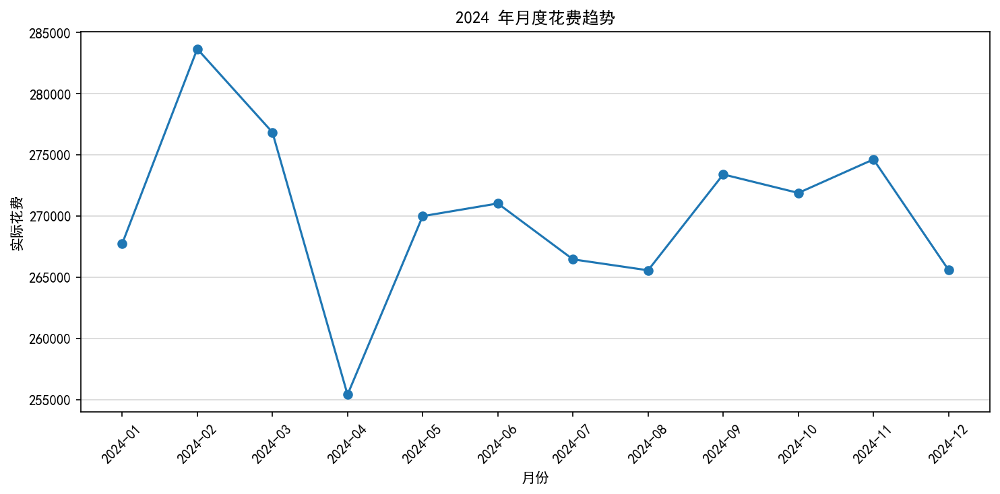
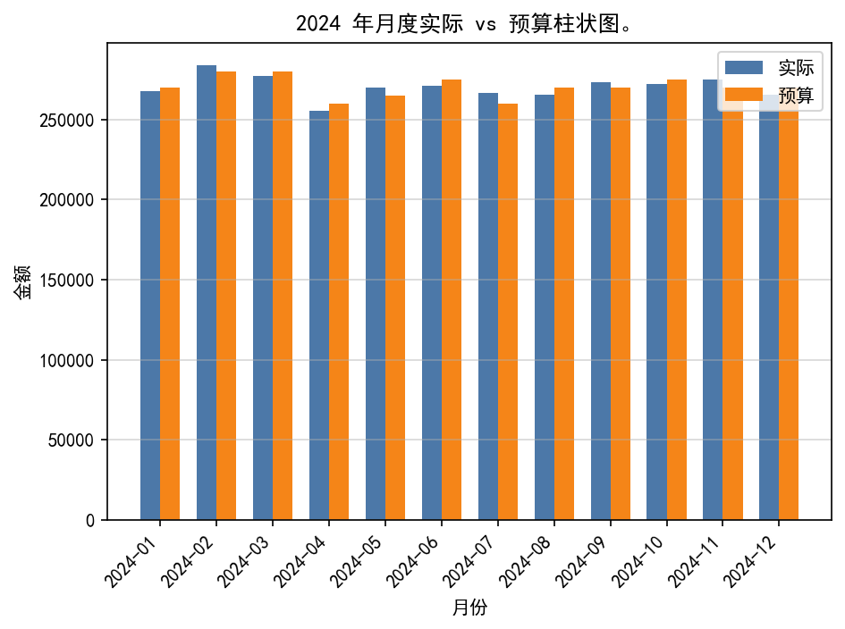

# 账单数据分析器

一个用 Python + pandas 实现的账单数据全流程工具：生成脏数据 → 体检 → 清洗 → 统计报表 → 数据可视化，覆盖从原始 CSV 到月度分类报表和图表的完整链路。

## 目录

- 功能
- 环境要求
- 安装依赖
- 项目结构
- 运行方式
- 数据说明
- 输出示例
- 数据可视化
- 常见问题

## 功能

- `generate_data.py`：使用固定随机种子 42，生成 2024 年 12 个月、每月 2000 条基础记录，并按比例混入脏数据与结构异常，输出 `data/data_sample.csv`
- `profile.py`：读取 CSV，打印重复表头、日期异常、金额异常、类别异常等统计
- `clean.py`：清洗数据，只保留 2024 年记录，输出 `data/cleaned.csv`
- `analyze.py`：按月/类别汇总，与 `data/budget.csv` 做 outer merge，打印月度与全年报表
- `plot.py`：`import analyze` 复用其函数，输出 3 张图到 `figures/`

## 环境要求

- Python 3.13+；依赖版本 pandas==3.1.0、matplotlib==3.10.8（记录在 `requirements.txt`）

## 安装依赖

在项目根目录执行：

```bash
pip install -r requirements.txt
```

`requirements.txt` 为 UTF-16 编码（带 BOM），个别编辑器或工具读取时可能显示异常。

## 项目结构

```text
.
├── generate_data.py    # 生成含脏数据的 data/data_sample.csv（固定种子，便于复现）
├── profile.py          # 数据体检：统计各类脏数据
├── clean.py            # 清洗数据：输出 data/cleaned.csv（只保留 2024 年）
├── analyze.py          # 统计报表：按月/类别汇总，并与 data/budget.csv 合并
├── plot.py             # 数据可视化：输出 3 张图到 figures/
├── data/               # 数据目录（需预先存在，脚本不自动创建）
│   ├── budget.csv      # 月度预算表（人工维护，入库）
│   ├── data_sample.csv # 运行时生成（generate_data.py 产出）
│   └── cleaned.csv     # 运行时生成（clean.py 产出）
├── figures/            # 运行时生成（plot.py 产出 3 张 PNG）
└── README.md           # 项目介绍
```

## 运行方式

在项目根目录按以下顺序执行：

```bash
python generate_data.py   # 生成 data/data_sample.csv（含脏数据）
python profile.py         # 体检：统计 data/data_sample.csv 中的脏数据
python clean.py           # 清洗，输出 data/cleaned.csv（只保留 2024 年）
python analyze.py         # 统计报表（读取 data/cleaned.csv 与 data/budget.csv）
python plot.py            # 可视化，输出 3 张图到 figures/
```

`analyze.py` 默认读取 `data/cleaned.csv`；`plot.py` 依赖 `data/cleaned.csv`，并在脚本内 `import analyze` 复用 `analyze.load()` 与 `analyze.monthly_report()`，因此需要与 `analyze.py` 位于同一目录。`profile.py`、`clean.py`、`analyze.py`、`plot.py` 都支持用第一个命令行参数指定输入文件。

## 数据说明

三个 CSV 都位于 `data/` 目录。

### 原始数据 `data/data_sample.csv`

由 `generate_data.py` 生成（固定随机种子 42，便于复现），包含以下三列：

| 列 | 说明 | 示例 |
|---|---|---|
| `日期` | 日期字符串 | `2024-01-15` |
| `类别` | 消费类别 | `餐饮` / `交通` / `购物` / `娱乐` |
| `金额` | 金额，可能带单位或非数字 | `35.5` / `35.5元` / `abc` |

- **日期异常**：不补零、斜杠分隔、带时间、空值、非法月/日、跨年
- **金额异常**：空、非数字、带“元”、千分位逗号、前后空格、负数、零、多小数点、科学计数法、全角数字
- **类别异常**：前后空格、大小写、别名、空值、未知类别
- **结构异常**：缺列、多列、空行、重复表头、完全重复行

### 清洗后数据 `data/cleaned.csv`

由 `clean.py` 输出，主要变化：

- 删除 `日期` 值为 `日期` 的重复表头行
- `日期` 转为日期类型，无法解析的行被删除；**硬编码只保留 2024 年的数据，跨年记录（如 `2023-12-31`）会被丢弃**，最终格式为 `YYYY-MM-DD`
- `金额` 去掉首尾空格和“元”后缀后转数值，无法转数值的行被删除；千分位逗号与全角数字未做转换，同样会因转换失败被删除
- `类别` 去首尾空格、转小写、别名映射为标准类别，非标准值归为“其他”
- 删除完全重复行，按日期升序排列并重置索引

### 预算表 `data/budget.csv`

人工维护的月度预算，两列：`月份`（如 `2024-01`）、`预算`。`analyze.py` 把实际花费按月与预算做 outer merge，按 `实际 - 预算` 计算差额，再用 `fillna(0)` 把缺失的月份或预算补 0，并汇总全年。

## 输出示例

以下为 `generate_data.py` 固定种子生成 `data/data_sample.csv` 后实跑的输出；`profile.py` 每个统计项后还会列出前 10 条样例，此处省略。

### `profile.py`：数据体检

```text
重复表头：528
日期缺失：339
长度不等于10： 806
含斜杠： 545
含空格： 391
无法转数字 1947
带空格 311
类别缺失：195
非类别 594
```
### `clean.py`：数据清洗

```text
无法解析的日期： 682 行
清洗前：25746 行
清洗后：20784 行
```

### `analyze.py`：统计报表

```text
2024-11 总花费：274623.4 预算：270000 差额：4623.4
  交通：65732.0（23.9%）
  购物：74376.2（27.1%）
  娱乐：64841.5（23.6%）
  餐饮：63675.9（23.2%）
  其他：5997.8（2.2%）

2024-12 总花费：265577.6 预算：270000 差额：-4422.4
  交通：64847.0（24.4%）
  购物：67391.2（25.4%）
  娱乐：65849.6（24.8%）
  餐饮：63851.3（24.0%）
  其他：3638.5（1.4%）

全年实际：3242104.1
全年预算：3245000
全年结余：-2895.9
```
## 数据可视化

```bash
python plot.py   # 在项目根目录执行，自动创建 figures/ 并输出 3 张 PNG
```

- `figures/monthly_trend.png`：2024 年月度花费趋势折线图
- `figures/actual_vs_budget.png`：2024 年月度实际 vs 预算柱状图
- `figures/category_pie.png`：2024 年各类别花费占比饼图

### 月度花费趋势



### 实际 vs 预算



图表中文依赖 `SimHei` 字体：`plot.py` 设置了 `plt.rcParams["font.sans-serif"] = ["SimHei"]` 和 `axes.unicode_minus = False`。

## 常见问题

- **未先生成 `data/cleaned.csv` 就运行 `analyze.py` 或 `plot.py`**：`pd.read_csv("data/cleaned.csv")` 抛出 `FileNotFoundError`，`plot.py` 在调用 `analyze.load()` 时报同样的错。
- **非 Windows 环境缺少 `SimHei` 字体**：图表中文显示为方块或乱码，并出现 matplotlib 的 `findfont` 警告；`plot.py` 未设置其他中文字体回退。
- **`data/budget.csv` 缺失或月份不匹配**：缺失 `data/budget.csv` 时 `analyze.py` 读取预算表抛出 `FileNotFoundError`；月份不匹配时 outer merge 保留两侧月份，缺失值经 `fillna(0)` 补 0，全年预算只累加 `data/budget.csv` 中存在的月份。
- **`data/` 目录不存在**：`generate_data.py` 与 `clean.py` 直接写入该目录下的文件，脚本本身不创建目录，会抛 `FileNotFoundError`。
